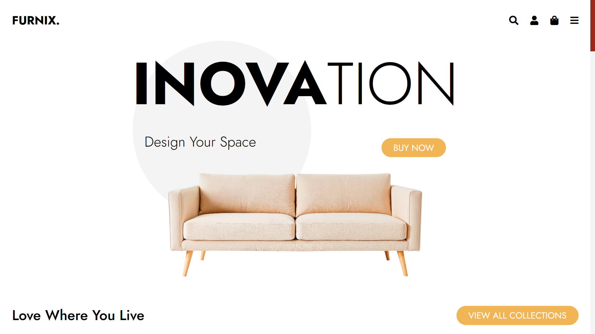

## 📸 Project Preview

## 🌐 Live Demo

Check out the live website:

[🚀 View FURNIX Live Demo](https://fahad03451481947-dev.github.io/Inovation-Ecommerce-Website/)

# 🛋️ FURNIX – Furniture E-Commerce Website

A modern and visually appealing furniture e-commerce website designed to showcase furniture collections and provide users with an attractive online shopping experience.

## 🛠️ Technologies

The following technologies were used to build this project:

- **HTML5:** Used to create the structure and semantic layout of the website.
- **CSS3:** Used for styling, layouts, animations, and responsive design.
- **JavaScript (ES6):** Used to implement interactive elements and dynamic website functionality.

## ✨ Features

- **Modern UI Design:** Clean, elegant, and visually appealing interface.
- **Responsive Design:** Optimized layout for desktop and mobile devices.
- **Hero Section:** Attractive homepage with featured furniture and a call-to-action button.
- **Product Collections:** Displays different furniture products in an organized layout.
- **New Arrivals:** Dedicated section to showcase newly added products.
- **Product Cards:** Attractive product cards with images, names, prices, and Add to Cart buttons.
- **About Us Section:** Provides information about the furniture brand.
- **Testimonials:** Displays customer feedback and reviews.
- **Mobile Navigation:** Interactive navigation menu for smaller screens.
- **Customer Benefits:** Highlights customer support, fast shipping, and secure payments.

## ⌨️ Keyboard Shortcuts

Currently, this project does not include custom keyboard shortcuts.

Users can still use standard browser keyboard shortcuts to navigate and interact with the website.

## ⚙️ The Process

I developed this project step by step, focusing on creating a modern and user-friendly furniture shopping experience.

1. **Planning:** Started by planning the website structure and identifying the main sections.
2. **HTML Structure:** Created the main layout using semantic HTML elements.
3. **CSS Styling:** Applied modern styling, spacing, typography, colors, and layouts to achieve a professional appearance.
4. **JavaScript Functionality:** Used JavaScript to implement interactive website elements.
5. **Responsive Design:** Optimized the layout and navigation for different screen sizes.
6. **Testing:** Tested the website in the browser and made adjustments to improve its appearance and usability.

## 📚 What I Learned

While building this project, I improved my understanding of:

- Writing clean and structured HTML.
- Creating modern website layouts using CSS.
- Using CSS Flexbox and Grid for layouts.
- Making websites responsive for different screen sizes.
- Implementing interactive elements using JavaScript.
- Managing DOM elements and handling user interactions.
- Improving website structure and user experience.
- Organizing frontend code for better readability and maintainability.

## 🚀 How It Can Be Improved

There are several ways this project can be improved in the future:

- **Shopping Cart:** Implement a fully functional shopping cart with quantity management.
- **Product Filtering:** Add filtering options based on categories, prices, and product types.
- **Search Functionality:** Allow users to search for specific furniture products.
- **User Authentication:** Add login and registration functionality.
- **Wishlist:** Allow users to save their favorite products.
- **Product Details:** Create dedicated pages with detailed product information.
- **Checkout System:** Implement a complete checkout and order management system.
- **Backend Integration:** Connect the website to a backend API and database to manage products and orders.

---

⭐ **If you like this project, feel free to give it a star on GitHub!**

**Developed with ❤️ using HTML, CSS, and JavaScript.**
